# BlackForestLab — FLUX.3 Action × NexArm

> **Vision-Language-Action auf dem eigenen Tisch-Roboter.**
> Ziel dieses Repos ist es, das open-weight **FLUX.3 Action**-Modell von Black Forest Labs so zu **fine-tunen**, dass es unseren **Hiwonder NexArm (6-DOF, Leader/Follower)** zuverlässig steuert — trainiert auf eigenen Demonstrationen, abgesichert über **MuJoCo-Simulation** und ausgeführt über eine **Cloud-GPU (AI Galaxy)**.

<p align="center">
  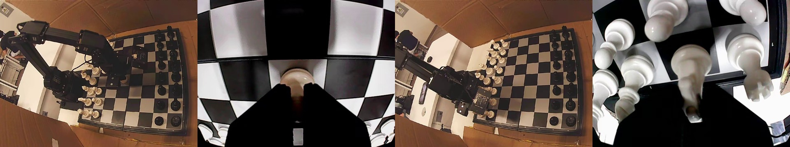
  <br>
  <em>Trainingsdaten — jeweils links: Scene-Cam (Arbeitsraum), rechts: Wrist-Cam (Greifer-Nahsicht). Links: Aufgabe „Schachbauer greifen“ (V1), rechts: „kleine Box auf große Box stapeln“.</em>
</p>

---

## Inhaltsverzeichnis

- [1 — Worum geht es? (Plan)](#1--worum-geht-es-plan)
- [2 — Warum FLUX.3 Action?](#2--warum-flux3-action)
- [3 — Systemübersicht](#3--systemübersicht)
- [4 — Repository-Struktur](#4--repository-struktur)
- [5 — Hardware: NexArm Follower + Leader](#5--hardware-nexarm-follower--leader)
- [6 — Datensätze & Trainingsvideos](#6--datensätze--trainingsvideos)
- [7 — MuJoCo-Simulation (ohne Hardware testen)](#7--mujoco-simulation-ohne-hardware-testen)
- [8 — Cloud-GPU: Training & Inference auf AI Galaxy](#8--cloud-gpu-training--inference-auf-ai-galaxy)
- [9 — Pipeline: Kalibrieren → Teleop → Aufnehmen → Trainieren → Inferenz](#9--pipeline-kalibrieren--teleop--aufnehmen--trainieren--inferenz)
- [10 — Installation (Windows 11)](#10--installation-windows-11)
- [11 — Troubleshooting & Sicherheit](#11--troubleshooting--sicherheit)
- [12 — Roadmap](#12--roadmap)
- [13 — Quellen & Lizenz](#13--quellen--lizenz)

---

## 1 — Worum geht es? (Plan)

Wir wollen **kein Modell von Grund auf trainieren**, sondern das bestehende **FLUX.3 Action** als Foundation nutzen und per **LoRA** auf unsere eigenen NexArm-Demonstrationen anpassen:

| Schritt | Was | Wo | Status |
|---|---|---|---|
| **A. Daten sammeln** | Leader→Follower Teleoperation, 2× USB-Kameras (scene + wrist), 30 FPS, 640×480, AV1 | `nexarm-f3a/5-record.cmd` → `H:\Meine Ablage\02_ARBEIT_&_PROJEKTE\FluxAction\lerobot\local\<dataset>` | ✅ Datensätze vorhanden (s. Kap. 6) |
| **B. Simulation** | Regelkreis mit gerenderten Bildern + Physik (Schachbrett + 32 Figuren) testen, inkl. Live-Browser-UI | `Schach/*.xml`, `nexarm-f3a/cloud/sim.py`, `sim_web.py`, `sim-web.cmd` | ✅ integriert |
| **C. Cloud-GPU** | Training & Inference brauchen CUDA — lokaler Laptop ist ARM/x64-Emulation ohne NVIDIA-GPU → alles auf **AI Galaxy** (`A800 40 GB` oder `RTX 5090 32 GB`) | `nexarm-f3a/cloud/galaxy.py`, `server.py`, `client.py` | ✅ integriert |
| **D. Fine-Tuning** | LoRA auf eigenen Daten (`examples/flux3/lora.json`, ~10k Micro-Steps, Batch 1–2) | `galaxy.py train / fetch / curves` | 🚧 nächster Schritt |
| **E. Deployment** | Modell als Server hinter SSH-Tunnel, Client sendet 8 History-Frames → Server liefert 32-Step-Chunk → Safety-Guards → 30 Hz an den Arm | `galaxy.py up` + `8-inference-execute.cmd` | ✅ Dry-Run sicher, Execute nach Freigabe |

**Ergebnis:** Natürlichsprachliche Kommandos wie *„put the small box on top of the big box“* oder *„greife den Schachbauern“* werden direkt in 6-DOF-Gelenkkommandos übersetzt — ohne klassische Bewegungsplanung.

> **Kernidee:** SO-101-kompatible Daten (Grad + Gripper 0–100, 2 Kameras, 30 Hz) sind formal schon F3A-kompatibel. Geometrisch bleibt ein Domain-Gap (SO-101 vs. NexArm-Kinematik) — den schließt erst das **Fine-Tuning** auf den eigenen Aufnahmen.

---

## 2 — Warum FLUX.3 Action?

**FLUX.3 Action** (Black Forest Labs, Apache-2.0) ist ein **Vision-Language-Action (VLA)**-Modell:

- **Input:** 8 aufeinanderfolgende Ticks (`n_obs_steps=8`) — je Tick: `scene` + `wrist` Bild (256×256 intern) + Gelenkzustand (6 Werte: 5× Grad + Gripper 0–100) + `last_command` + englischer Task-String.
- **Output:** 32 absolute Gelenkkommandos (`n_action_steps=32`, ~1 s bei 30 Hz), intern als Deltas zum letzten `command_history` vorhergesagt und über gelernte Normalisierung zurück in Grad/% gewandelt.
- **Backbone:** Action-DiT + gefrorener Text-Encoder + Video-VAE; Checkpoints: `flux-3-action-so101` (Policy) und `flux-3-action-base` (VAE + Text-Encoder, ~25 GB zusammen).
- **Training:** LoRA-Adapter auf den eigenen Daten statt Full-Fine-Tune — passt auf 32–40 GB VRAM.

Hugging-Face-Links (jeweils **Lizenz akzeptieren** + Read-Token nötig):

- https://huggingface.co/black-forest-labs/flux-3-action-so101
- https://huggingface.co/black-forest-labs/flux-3-action-base

Lokal läuft nur der **Client** (`cloud/client.py`); das schwere Modell läuft ausschließlich auf der **Cloud-GPU** hinter `cloud/server.py`.

---

## 3 — Systemübersicht

```
┌─────────────────────────────────────────────────────────────────────────┐
│  Laptop (Windows 11 ARM, ohne CUDA)                                     │
│                                                                         │
│  NexArm Leader ──USB──┐                                                 │
│                       │  30 Hz                                          │
│  NexArm Follower ──USB─┤  scene + wrist (640×480) + state (6)            │
│  2× USB-Kameras ───────┘                                                 │
│            │                                                            │
│            │  8 History-Frames + Task (JPEG 256×256, Base64)            │
│            ▼                                                            │
│  cloud/client.py  ──SSH-Tunnel (127.0.0.1:8000)──►  AI Galaxy GPU        │
│    • Safety-Guards (jump/step/span)        │         cloud/server.py    │
│    • 30 Hz send_action / Dry-Run           │         FLUX.3 Action      │
│    • Logging (outputs/cloud_client.jsonl)  │         LoRA-Adapter (opt) │
│            │                               │                            │
│            ▼                               │                            │
│  MuJoCo sim.py (alternativ, ohne Hardware) ◄┘  gleiche Schnittstelle    │
└─────────────────────────────────────────────────────────────────────────┘
```

**Schleife (real oder simuliert):**

`observe (state + 2 Bilder)` → `POST /predict {task, frames[8]}` → `32 Kommandos` → **Safety-Check (gesamter Chunk wird verworfen wenn ein Sprung zu groß ist)** → `send_action` bei 30 Hz + `precise_sleep` → nächste Runde mit letzten 8 Ticks als History. Während der Server rechnet, hält der Arm die Position.

---

## 4 — Repository-Struktur

```
BlackForestLabFluxAction3/               ← dieses Repo (Root wird gepusht)
├── README.md                            ← diese Datei
├── assets/training/                     ← Screenshots aus echten Trainingsvideos (s. Kap. 6)
│   ├── hero_montage.jpg
│   ├── v1_schachbauer_dual_*.jpg        ← Scene+Wrist kombiniert
│   └── stack_boxes_20261120_dual_*.jpg
├── NEXARM-SETUP.md                      ← ursprüngliches Windows-ARM Setup
├── check_cameras.py / check_dataset.py  ← Diagnose-Helfer
├── setup-nexarm.ps1 / verify-nexarm.ps1
│
├── Schach/                              ← ♟️ MuJoCo-Schach-Szene (Schachbrett + 32 Figuren)
│   ├── chess_scene.xml                  ← Hauptszene (inkl. nexarm.xml, workcell.xml, board + pieces)
│   ├── board.xml                        ← 64-Felder-Schachbrett (a1..h8, 25 mm Felder)
│   └── pieces.xml                       ← 32 freie Schachfiguren (w_*/b_*) mit Greifer-Kollision
│
├── nexarm-f3a/                          ← ⭐ Hauptarbeitsverzeichnis (upstr. LeRobot + Plugin)
│   ├── plugin/                          ← uv-Projekt: lerobot + lerobot_robot_nexarm (F3A-kompatibel)
│   ├── calibration/follower|leader/     ← gemessene Nullpunkte + drive_mode (0 Grad, Richtungen)
│   ├── config/
│   │   ├── record.yaml                  ← F3A-Aufnahme: use_degrees:true, scene+wrist, streaming_encoding
│   │   ├── inference.yaml               ← Follower-Port + Kameras + Kalibrierung (Real & Sim)
│   │   └── teleop*.yaml
│   ├── cloud/                           ← FLUX.3 Action Cloud-Stack (aus mariorch22/lerobot-nexarm adaptiert)
│   │   ├── server.py                    ← FastAPI /predict, lädt SO101 + Adapter, /health
│   │   ├── client.py                    ← Laptop-Client, Safety-Guards, FakeRobot, Sim-Anbindung
│   │   ├── sim.py                       ← MuJoCo NexArm (nutzt JointNormalizer aus config/inference.yaml)
│   │   ├── sim_web.py                   ← Interaktives Browser-Dashboard (MJPEG-Stream, Prompt, Trajektorien)
│   │   ├── galaxy.py                    ← AI-Galaxy Orchestrierung (setup/up/train/logs/fetch/status)
│   │   ├── setup_remote.sh              ← Remote-Setup: env + Gewichte (~25 GB)
│   │   ├── replay_eval.py               ← Offline-Vergleich gegen zurückgehaltene Episoden
│   │   └── .env.example                 ← Vorlage für SSH_HOST/PORT, REMOTE_DIR, HF_TOKEN
│   ├── tools/ / tests/ / third_party/
│   ├── 1-calibrate-follower.cmd … 6-record-continue.cmd  ← Doppelklick-Pipeline
│   ├── 7-inference-dryrun.cmd / 8-inference-execute.cmd
│   ├── sim-web.cmd / sim-test.cmd / viewer.cmd / shell.cmd
│   └── setup.ps1 / _env.cmd
│
├── finsh/                               ← Hiwonder-Fork (gepinnt + NexArm-Treiber) — gitignored, per finsh.zip
│   └── README_NEXARM.md                 ← ausführliche 6-Schritt-Anleitung (chinesisch/deutsch)
├── lerobot-nexarm/                      ← 2. Hiwonder-Fork-Kopie — gitignored
└── datasets/  (leer, Daten liegen auf H:)  ← .gitignore
```

> **Wichtig:** `/finsh`, `/lerobot-nexarm`, `/nexarm-f3a/plugin`, `/nexarm-f3a/third_party` und alle `outputs/`, `*.mp4`, `.env` sind **gitignored**. Das Repo enthält nur die Orchestrierung + Doku + die Screenshots in `assets/`. Datasets liegen außerhalb des Repos unter `H:\Meine Ablage\02_ARBEIT_&_PROJEKTE\FluxAction\lerobot\local`.

---

## 5 — Hardware: NexArm Follower + Leader

| Komponente | Details |
|---|---|
| **Follower** | ESP32 + AT32F421 Co-Prozessor, 6× HX-30HM Bus-Servos, 12-bit (0–4095), 1 Mbps, CommProtocol `FF FF ID LEN CMD … CHECKSUM` (CMD 56/68/96/97/98) |
| **Leader** | ESP32, 6× HX-30HM, torque-frei zum freien Führen |
| **Kameras** | 2× USB: `scene` (Arbeitsraum-Überblick) + `wrist` (Greifer-Nahsicht), 640×480 @ 30 FPS |
| **Gelenke (6 DOF)** | `shoulder_pan` (Basis), `shoulder_lift` (Leader↔Follower gespiegelt: 4096−pos), `elbow_flex`, `wrist_flex`, `wrist_roll`, `gripper` (1195–2833 raw → 0–100 %) |
| **Ports** | Windows: `COM10` (Follower) / `COM15` (Leader) o.ä. — in `_env.cmd` zentral konfigurierbar |

**Kalibrierung** ist entscheidend: Beim ersten `ENTER` in `1-`/`2-calibrate-*.cmd` wird die **SO-101-Mittelpose** als 0 Grad für alle 5 Armgelenke festgelegt. `drive_mode` in `calibration/follower/follower.json` bestimmt die Vorzeichen. Der Leader rechnet mit der Follower-Datei — Richtungen nur dort ändern.

---

## 6 — Datensätze & Trainingsvideos

Alle Datensätze liegen auf **Google Drive** (via `HF_LEROBOT_HOME`) unter:

```
H:\Meine Ablage\02_ARBEIT_&_PROJEKTE\FluxAction\lerobot\local\
├── V1SchachBauer\                 ← 15 Episoden, 7 644 Frames, 30 FPS (älterer Schachbauer-Task)
├── BauerV2\                       ← 20 Episoden, 6 305 Frames — aktive Weiterentwicklung
├── nexarm_f3a_stack_boxes_20261120_154729\  ←  Boxes stapeln, 30 FPS, F3A-kompatibel (Grad, scene+wrist)
└── Old Data\nexarm_f3a_stack_boxes_20261113_*  ← frühere Box-Aufnahmen
```

**Format (F3A-kompatibel):** `action` / `observation.state` in **Grad** (Gripper 0–100), `observation.images.scene` + `observation.images.wrist` als AV1-MP4 (PyAV), 30 FPS, `task: "put the small box on top of the big box"` bzw. Schachbauer-Variante. `check-dataset.cmd` muss `OK` melden — `FAIL` heißt Kalibrierung oder Kamera fehlerhaft.

### Screenshots aus echten Trainingsvideos

> Alle Bilder stammen direkt aus den MP4s in `H:\Meine Ablage\02_ARBEIT_&_PROJEKTE\FluxAction\lerobot\local` — je Episode ein Frame vom **Start**, aus der **Mitte** und vom **Ende** des Ablaufs — und liegen versioniert unter `assets/training/`.

#### Aufgabe A — Schachbauer greifen (`V1SchachBauer`)

| Phase 1 — Anfahrt | Phase 2 — Greifen | Phase 3 — Ablage |
|---|---|---|
| 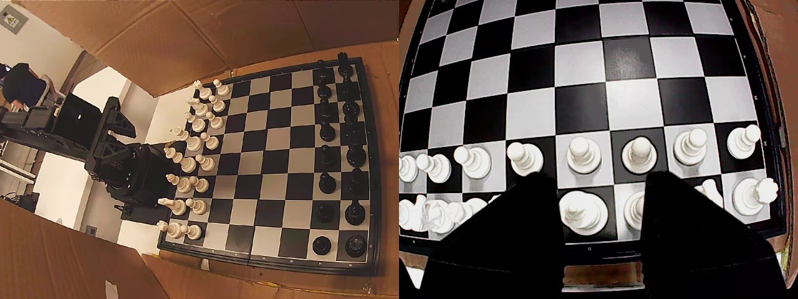 | 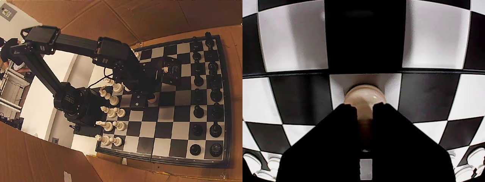 | 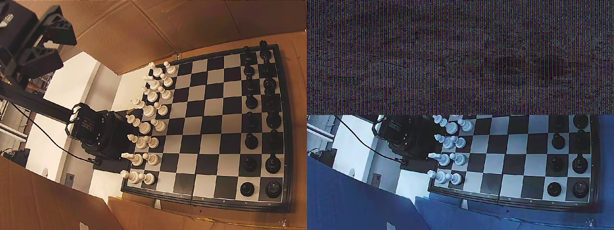 |
| *Annäherung — Scene links, Wrist rechts* | *Greifer schließt — Wrist zeigt Kontakt* | *Absetzen / Rückzug* |

<details>
<summary>Einzelansichten V1 (Scene / Wrist getrennt)</summary>

| Phase | Scene | Wrist |
|---|---|---|
| Anfahrt | 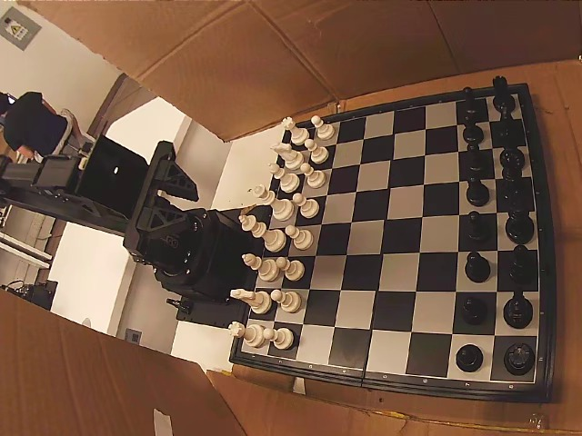 | 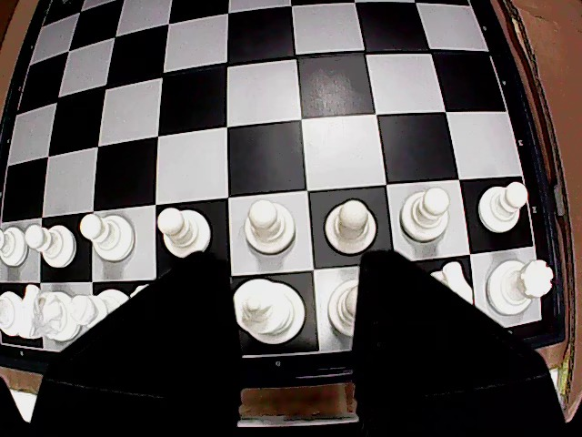 |
| Greifen | 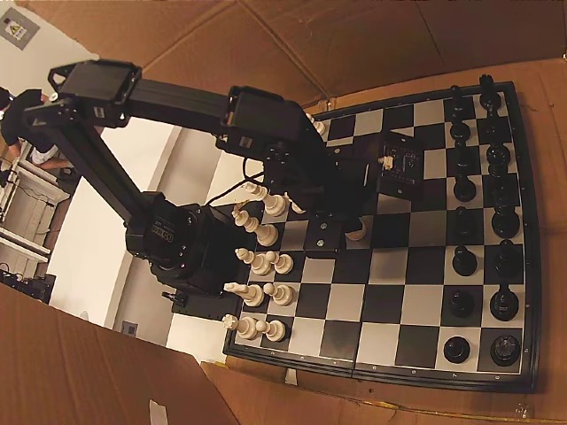 | 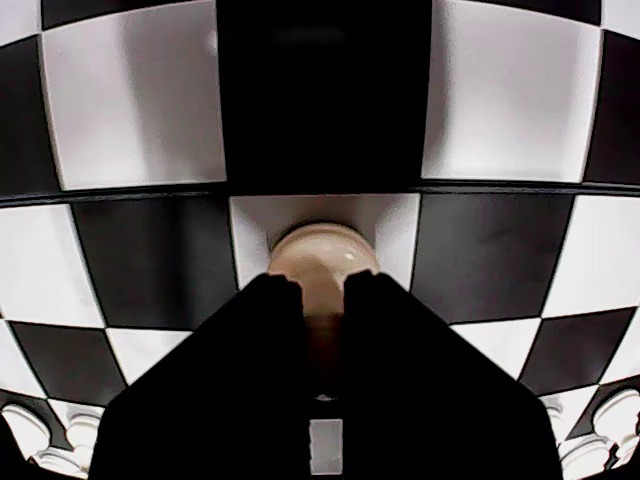 |
| Ablage | 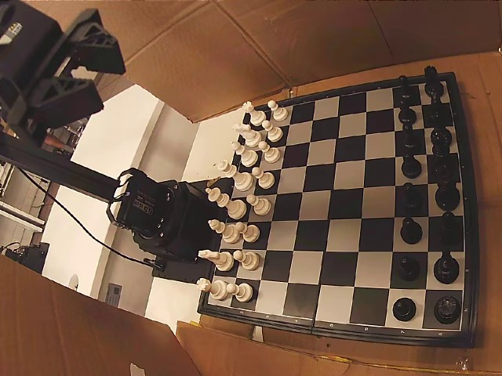 | 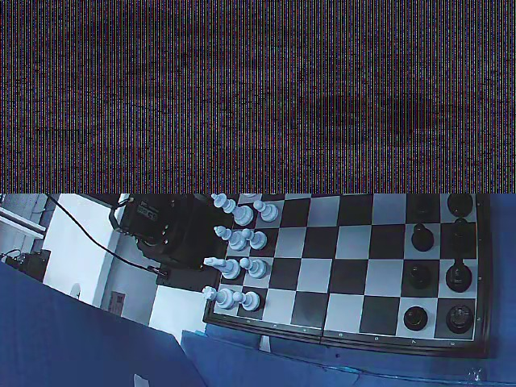 |

</details>

#### Aufgabe B — Boxen stapeln (`nexarm_f3a_stack_boxes_20261120`)

| Phase 1 — Anfahrt | Phase 2 — Anheben | Phase 3 — Absetzen |
|---|---|---|
| 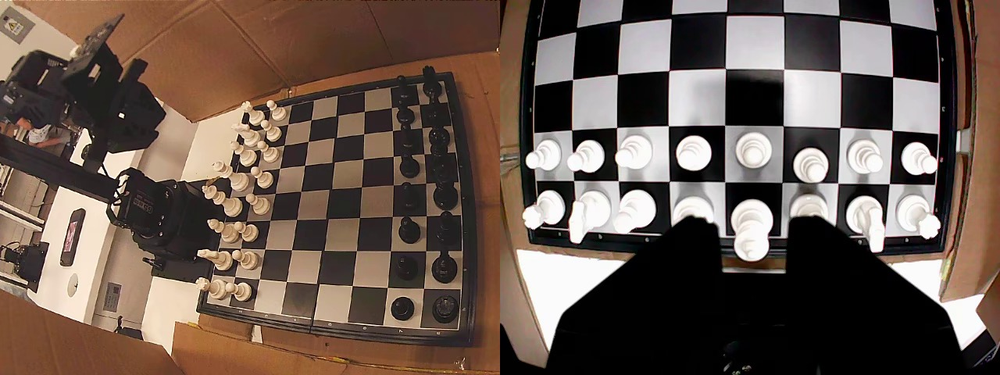 | 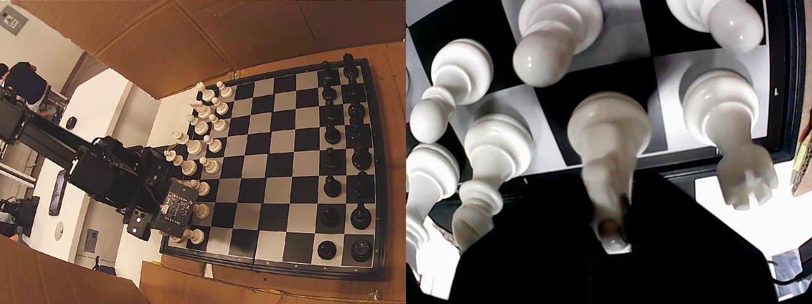 | 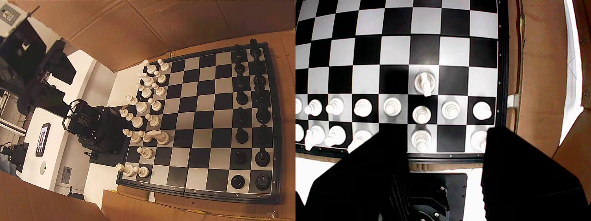 |
| *Kleine Box anfahren* | *Anheben* | *Auf großer Box absetzen* |

<details>
<summary>Einzelansichten Boxen (Scene / Wrist getrennt)</summary>

| Phase | Scene | Wrist |
|---|---|---|
| Anfahrt | 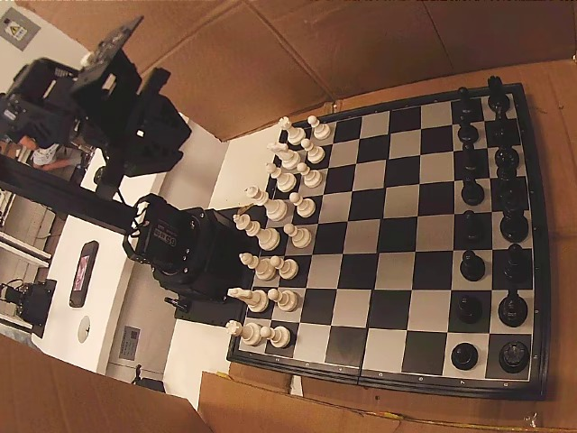 | 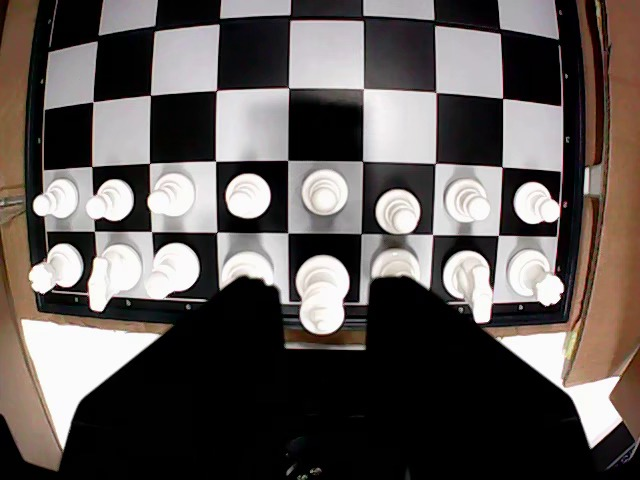 |
| Anheben | 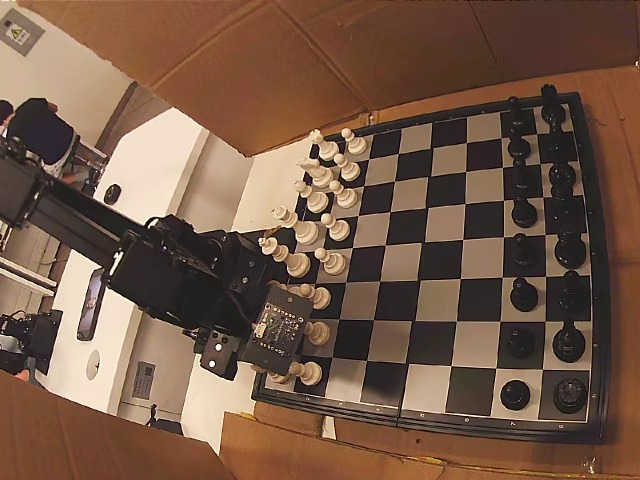 | 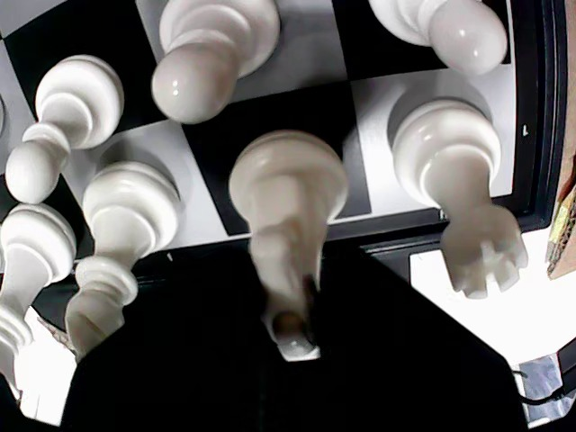 |
| Absetzen | 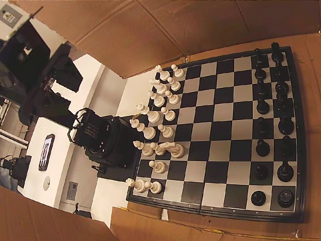 | 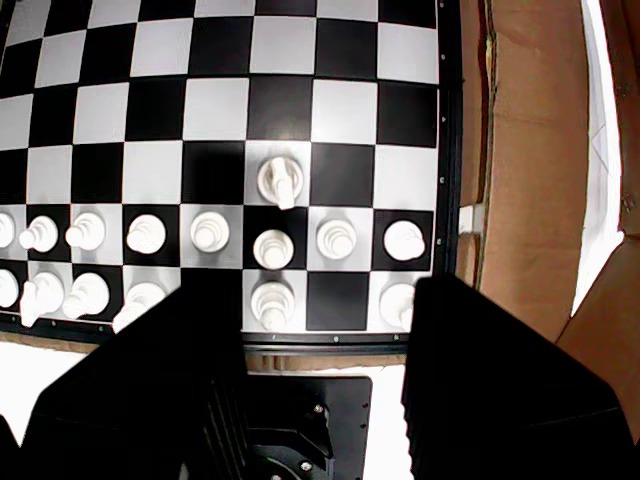 |

</details>

> **Hinweis BauerV2:** Die Scene-Spur von `BauerV2` lag während des Screenshots noch im Streaming-Tmp (`tmp9zj6mkyj/observation.images.scene_streaming.mp4`) und war nicht final muxed — deshalb hier nur `V1` + `stack_boxes` gezeigt. Nach Abschluss der Aufnahme verhält sich `BauerV2` identisch zu `V1`.

---

## 7 — MuJoCo-Simulation (ohne Hardware testen)

Gefahrloses Testen der kompletten Regelschleife mit Physik, Schachbrett (`Schach/chess_scene.xml`, 64 Felder + 32 Figuren) und gerenderten Kamerabildern:

```powershell
# 1. Arm-Modell holen (einmalig, inkl. LFS-Assets)
git clone --depth 1 https://github.com/khanhthanhdev/lerobot-nexarm.git nexarm-f3a/third_party/khanhthanhdev-lerobot-nexarm
git -C nexarm-f3a/third_party/khanhthanhdev-lerobot-nexarm lfs pull --include "sim/assets/**"

# 2a. Interaktives Live-Browser-Studio (http://127.0.0.1:8080)
nexarm-f3a/sim-web.cmd

# 2b. CLI-Bewegungstest ohne GPU (Mock-Server + Simulation -> outputs/sim.mp4)
uv run nexarm-f3a/cloud/server.py --mock-sweep          # Terminal 1
nexarm-f3a/sim-test.cmd --chunk-gripper-span 0           # Terminal 2 → outputs/sim.mp4

# 2c. Echte FLUX-Inferenz per CLI in der Schach-Simulation (braucht laufenden Tunnel s. Kap. 8)
python nexarm-f3a/cloud/client.py --sim Schach/chess_scene.xml --config nexarm-f3a/config/inference.yaml --video outputs/sim.mp4 --task "move white pawn e2 to e4" --execute
```

### Live-Browser-Studio (`sim-web.cmd` / `cloud/sim_web.py`)
- **Live-MJPEG-Kamerastream (30 Hz)**: Umschaltbar zwischen **`Dual`** (`scene` + `wrist`), **`Scene`**, **`Wrist`** und **`Top`** (Vogelperspektive über dem Schachbrett).
- **Prompt & Steuerung**: Text-Input für Task-Prompts (`Enter` sendet sofort), Quick-Presets, **`Step 32`** (einzelnen 32-Step-Chunk anfragen & abfahren), **`Run Loop`** (durchgehende Regelschleife), **`Dry-Run (Plan Only)`** (Modell-Antwort ohne Armbewegung inspizieren), **`Reset Board`** und **`Randomize Opening`**.
- **Action Chunk Telemetry (6-DOF Sparklines)**: Zeigt für alle 6 Gelenke die 8 History-Ticks, die 32 vorhergesagten Steps vom Modell als Kurve, Inferenz-/Roundtrip-Latenz, Safety-Guard-Status sowie die 32×6-Kommandotabelle.
- **Identische Normalisierung wie am echten Arm**: `sim.py` lädt `config/inference.yaml` und nutzt denselben `JointNormalizer` (`calibration/follower/follower.json`: `homing_offset`, `drive_mode`, `range_min..range_max`, `use_degrees`) wie `NexArmFollower`.
- **Eingebaute Demo-Backends**: Über das Dropdown oben rechts lässt sich jederzeit zwischen **`Port 8000 (FLUX.3)`** (echtes Modell auf AI Galaxy) und **`Demo: Pawn e2 → e4`** (fährt ohne GPU den Schachzug `e2 → e4` vor) umschalten.

---

## 8 — Cloud-GPU: Training & Inference auf AI Galaxy

**Warum Cloud?** Der Entwicklungs-Laptop ist Windows 11 ARM ohne NVIDIA-GPU. Training und selbst Inference von FLUX.3 Action brauchen CUDA. Die Lösung: **AI Galaxy** (`gpu.ai-galaxy.com`, Minutenabrechnung).

| Karte | VRAM | Wofür | Hinweis |
|---|---|---|---|
| **A800-SXM4-40GB** | 40 GB | Allrounder, empfohlen für LoRA-Training (`--batch-size 2`) | Nach Boot `nvidia-smi` prüfen: Host-CUDA **≥12.8** (Treiber ≥570), sonst sofort **结束** und auf 5090 wechseln |
| **RTX 5090** | 32 GB | Schnellste Live-Inferenz | Training mit `--batch-size 1` + `--text-encoder-on-cpu` (~8 GB gespart) |
| **Disk** | 80–120 GB | Modelle + Daten + Outputs | Auf Instance `df -h && lsblk` prüfen — oft `/root/data` oder `/data`; Pfad als `REMOTE_DIR` in `cloud/.env` eintragen |

> **Kostenfalle:** Auf AI Galaxy stoppt **nur `结束` (End/Release)** die Abrechnung — `关机` (Shut Down) läuft kostenpflichtig weiter!

### 8.1 Einmalige Vorbereitung (Hugging Face + SSH)

1. Auf **huggingface.co** (nicht `hf-mirror.com`) einloggen und bei beiden gated Repos *Agree and access repository* klicken (s. Kap. 2).
2. Unter `huggingface.co/settings/tokens` einen **Read-Token** (`hf_...`) erstellen.
3. `nexarm-f3a/cloud/.env.example` → `nexarm-f3a/cloud/.env` kopieren und `SSH_HOST`, `SSH_PORT`, `REMOTE_DIR`, `HF_TOKEN` eintragen (`.env` ist gitignored).
4. SSH-Key (einmalig, PowerShell):

```powershell
if (!(Test-Path "$env:USERPROFILE\.ssh\id_ed25519")) { ssh-keygen -t ed25519 -N '""' -f "$env:USERPROFILE\.ssh\id_ed25519" }
Get-Content "$env:USERPROFILE\.ssh\id_ed25519.pub" | ssh -p <SSH_PORT> root@<SSH_HOST> "mkdir -p ~/.ssh && chmod 700 ~/.ssh && cat >> ~/.ssh/authorized_keys && chmod 600 ~/.ssh/authorized_keys"
```

### 8.2 Typischer Ablauf (alle Befehle in `nexarm-f3a/` via `shell.cmd`)

```powershell
# Status: SSH OK? GPU da? Disk frei? Tunnel gesund?
python cloud/galaxy.py status

# Setup: LeRobot-Env + ~25 GB Gewichte laden (auf CPU-Host mit --cpu)
python cloud/galaxy.py setup

# Server starten (tmux) + Tunnel nach http://127.0.0.1:8000 öffnen
python cloud/galaxy.py up
# mit eigenem Adapter:  python cloud/galaxy.py up --adapter outputs/lora/nexarm_lora/pretrained_model
# auf 32-GB-Karte:      python cloud/galaxy.py up --text-encoder-on-cpu

# --- in zweitem Fenster (shell.cmd oder Doppelklick) ---

# Tunnel & Server ohne Arm testen
python cloud/client.py --fake-robot --task "put the small box on top of the big box"

# Dry-Run am echten Arm (sendet KEINE Bewegung, prüft Kamera/Kalibrierung/Plan)
7-inference-dryrun.cmd

# Echte Bewegung (erst nach erfolgreichem Dry-Run & gesetzten Limits!)
8-inference-execute.cmd
```

### 8.3 LoRA-Training auf eigenen Daten

```powershell
# A800 (40 GB, Default batch_size=2):
python cloud/galaxy.py train --dataset "H:\Meine Ablage\02_ARBEIT_&_PROJEKTE\FluxAction\lerobot\local\V1SchachBauer"

# RTX 5090 (32 GB):
python cloud/galaxy.py train --dataset "H:\Meine Ablage\02_ARBEIT_&_PROJEKTE\FluxAction\lerobot\local\V1SchachBauer" --batch-size 1

# Logs live, Kurven-Tabelle, Adapter holen
python cloud/galaxy.py logs
python cloud/galaxy.py curves
python cloud/galaxy.py fetch          # → outputs/lora/nexarm_lora/pretrained_model

# Offline-Eval gegen zurückgehaltene Episoden (Server muss laufen)
python cloud/replay_eval.py --dataset "H:\...\V1SchachBauer" --episodes 14 15 16 17
```

Training: `examples/flux3/lora.json` + LoRA-Recipe aus BFL, 10k Micro-Steps (20k bei batch_size 1), `HF_HUB_OFFLINE=1`, `PYTORCH_CUDA_ALLOC_CONF=expandable_segments:True`. Checkpoints unter `outputs/<run>/checkpoints/last/pretrained_model`.

### 8.4 Was passiert hinter `galaxy.py`?

- `upload` / `upload_dir` via Tar-Streams (kein `scp` nötig, Windows-Zeilenenden werden normalisiert)
- `setup_remote.sh` installiert `uv`, LeRobot-Env und lädt beide HF-Repos
- `up` startet `server.py` in `tmux -s f3a`, wartet bis `/health == ready` (lädt ~80 s)
- SSH-Tunnel `-L 8000:127.0.0.1:8000`; `Ctrl+C` schließt **nur** den Tunnel — die Instanz läuft weiter bis `结束`

---

## 9 — Pipeline: Kalibrieren → Teleop → Aufnehmen → Trainieren → Inferenz

**Alles per Doppelklick in `nexarm-f3a/` — immer nur ein Fenster gleichzeitig an den Armen!**

| # | Skript | Was | Erfolgskriterium |
|---|---|---|---|
| 1 | `1-calibrate-follower.cmd` | Follower abstützen (Torque aus), Mittelpose → ENTER, dann jedes Gelenk langsam durch Anschläge → ENTER | `calibration/follower/follower.json` entsteht |
| 2 | `2-calibrate-leader.cmd` | Gleicher Ablauf am Leader | `calibration/leader/leader.json` |
| 3 | `3-teleop-no-cameras.cmd` | Follower folgt Leader ohne Kameras | Jedes Gelenk läuft in richtige Richtung |
| 4 | `4-teleop.cmd` | Teleop + Kameras + Live-Ansicht | Beide Bilder scharf, 30 FPS |
| 5 | `5-record.cmd` | Nimmt 20 Episoden nach `local/nexarm_f3a_stack_boxes_<Zeitstempel>` auf (40 s Episode, 25 s Reset, → zum Beenden) | Dataset wächst unter `H:\…\local\` |
| 6 | `check-dataset.cmd` | Validiert F3A-Kompatibilität | Muss `OK` melden — `FAIL` = Kalibrierung/Bereich falsch |
| 7 | `6-record-continue.cmd` | Setzt unterbrochene Aufnahme bis 20 Episoden fort | — |
| 8 | `7-inference-dryrun.cmd` | `client.py --task ...` ohne `--execute` | Logs zeigen 30 Hz, keine Moves, `outputs/cloud_client.jsonl` |
| 9 | `8-inference-execute.cmd` | Echte Fahrt mit Guards | Arm bewegt sich, Guards greifen bei Sprüngen |
| — | `sim-web.cmd` | Interaktives MuJoCo-Schach-Studio im Browser (`http://127.0.0.1:8080`) | Live-Stream (`Dual/Scene/Wrist/Top`), Prompt-Eingabe, 32-Step-Kurven |
| — | `sim-test.cmd` | MuJoCo-CLI-Loop ohne Hardware | `outputs/sim.mp4` |

**Konfiguration zentral:** Ports/Dataset-Name/Zielanzahl oben in `_env.cmd` (aktuell `COM10`/`COM15`), Kameras/Aufgabe/Längen in `config/record.yaml` bzw. `config/inference.yaml`.

---

## 10 — Installation (Windows 11)

### Variante A — isoliert über `nexarm-f3a/setup.ps1` (empfohlen für F3A)

```powershell
Set-ExecutionPolicy -Scope Process Bypass
cd nexarm-f3a
.\setup.ps1
```

Das klont das Plugin nach `plugin/`, installiert Python 3.12 (x64) + Env nach `uv.lock` und lässt die Plugin-Tests laufen. Die alte Conda-Umgebung `nexarm`/`finsh` bleibt unberührt.

Danach: `shell.cmd` öffnet eine Prompt mit aktiver Env — `lerobot-find-port`, `lerobot-find-cameras opencv`, `python cloud/galaxy.py ...` laufen dort.

### Variante B — manuell (Hiwonder-Pfad, nur zum Vergleich)

```powershell
conda create -n nexarm python=3.12 -y
conda activate nexarm
cd finsh
pip install -e ".[nexarm]"          # + optional .[nexarm,viz] für Rerun
pip install -e ".[nexarm,training]" # für ACT-Training (nicht F3A)
```

Validierung:

```powershell
python -m lerobot.scripts.lerobot_find_port
python -m lerobot.scripts.lerobot_find_cameras opencv
python -c "from lerobot_robot_nexarm.bus import JOINT_NAMES; print(JOINT_NAMES)"
```

---

## 11 — Troubleshooting & Sicherheit

### Safety-Guards (`cloud/client.py`)

Vor dem Senden wird **der gesamte 32-Step-Chunk** geprüft; bei Verstoß wird der Chunk verworfen und die Runde neu geplant:

| Guard | Default | Was |
|---|---|---|
| `arm_jump` | 15° | Erste Kommando zu weit vom Ist-Zustand (Arm) |
| `gripper_jump` | 30 pp | Erster Gripper-Sprung |
| `step_arm_jump` | 10° | Sprung zwischen zwei aufeinanderfolgenden Steps (Arm) |
| `step_gripper_jump` | 25 pp | Sprung zwischen Steps (Gripper) |
| `chunk_arm_span` | 45° | Maximale Abweichung irgendeines Steps vom Ist (Arm) |
| `chunk_gripper_span` | 60 pp | Maximale Gripper-Abweichung im Chunk |

Alle per CLI überschreibbar (`--arm-jump`, `--chunk-arm-span 0` zum Deaktivieren etc.). Dry-Run zeigt Guard-Auslösungen im Log ohne jede Bewegung.

### Häufige Fehler

| Symptom | Ursache / Fix |
|---|---|
| `TimeoutError: No position reply from NexArm` | Leader-Firmware spamt `[WARN]`/`[POS]` über Serial → Treiber retryt 3× (in `plugin/…/bus.py` bereits abgefangen). Dauerhaft: `Serial.printf` in `Nex_Arm.ino` im `lerobotMode==true`-Zweig auskommentieren und neu flashen. |
| `FAIL` bei `check-dataset.cmd` | Kalibrierbereich außerhalb 1195–2833, `drive_mode` falsch, oder Gelenk gespiegelt. `follower.json` prüfen; pro Gelenk `0:+`, `1:−`, Gripper `1` = 0 geschlossen. |
| Kamera schwarz / falscher Index | `check-cameras.cmd` / `lerobot-find-cameras opencv` erneut laufen lassen — USB-Reihenfolge ändert Indizes. Keine 2 Kameras am selben Hub-Zweig. |
| `Checksum error` | Bekannter Firmware-Bug (`tx_packet_complete` nutzt falsche Länge). Treiber akzeptiert beide Checksums. |
| `SSH tunnel exits` | Lokaler Port 8000 belegt — anderen Port via `--port` wählen; `galaxy.py status --port <n>`. |
| Training OOM auf 5090 | `--batch-size 1` + `--text-encoder-on-cpu` (siehe Kap. 8.3). |
| Modell kollabiert (zittert / kaum Bewegung, wie bei ACT beobachtet) | Bei F3A-LoRA: Batch erhöhen, Episoden konsistenter aufnehmen, Steps erhöhen, zuletzt Lernrate anheben. |

---

## 12 — Roadmap

- [x] F3A-kompatible Aufnahme (`use_degrees`, `scene`/`wrist`, `streaming_encoding`)
- [x] Kalibrierung mit SO-101-Mittelpose + `drive_mode`
- [x] MuJoCo-Schach-Sim (`Schach/chess_scene.xml`, `sim.py`, `sim_web.py`, `sim-web.cmd`) inkl. Live-Browser-UI & `JointNormalizer`-Anbindung
- [x] Cloud-Stack: `server.py` + `client.py` (Guards, FakeRobot) + `galaxy.py` (AI Galaxy) + `setup_remote.sh`
- [x] Dry-Run / Execute getrennt (`7`/`8-*.cmd`)
- [x] Trainingsvideos + Screenshots versioniert (`assets/training/`)
- [ ] **LoRA-Training auf `V1SchachBauer` / `BauerV2` / `stack_boxes`** und Adapter-Eval (`replay_eval.py`)
- [ ] Real-Rollouts mit Adapter (`galaxy.py up --adapter …` + `8-inference-execute.cmd`)
- [ ] Erfolgsraten messen (Greifen / Stapeln) und Hyperparams tunen (Steps, LR, Batch)
- [ ] Optional: ACT-Baseline zum Vergleich, Datensätze >50 Episoden, Erweiterung auf weitere Tasks

---

## 13 — Quellen & Lizenz

- **LeRobot** (Hugging Face, Apache-2.0): https://github.com/huggingface/lerobot — ICLR 2026 Paper: *LeRobot: An Open-Source Library for End-to-End Robot Learning*.
- **FLUX.3 Action** (Black Forest Labs): SO101 + Base (weight-Lizenz auf HF akzeptieren).
- **NexArm** (Hiwonder) — Hardware + ESP32/AT32-Firmware + HX-30HM.
- **Dieses Repo** integriert gezielt Bausteine aus `mariorch22/lerobot-nexarm` und `khanhthanhdev/lerobot-nexarm` (beide Apache-2.0) und passt sie für AI Galaxy an. Eigene Orchestrierung (`galaxy.py`, `client.py`-Guards, `sim.py`-Anpassungen) steht unter derselben Apache-2.0, sofern nicht anders vermerkt. HF-Gewichte und NexArm-Firmware unterliegen ihren jeweiligen Lizenzen.

```
@misc{cadene2024lerobot,
  author  = {Cadene, Remi and Alibert, Simon and Soare, Alexander and others},
  title   = {LeRobot: State-of-the-art Machine Learning for Real-World Robotics in Pytorch},
  howpublished = "\url{https://github.com/huggingface/lerobot}",
  year    = {2024}
}
```

---

<p align="center">
  <sub>BlackForestLab — SZTU · NexArm · FLUX.3 Action · 2026</sub>
</p>
